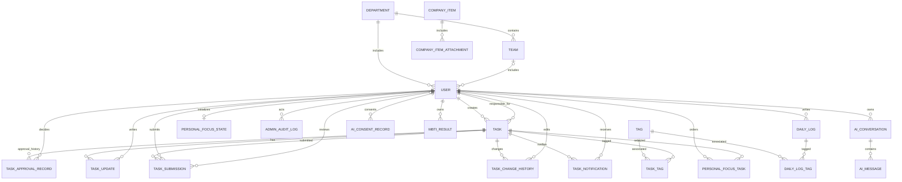

# 后端数据库设计

## Issue #6 已落地的数据模型

本节记录 Issue #6 已落地及 Issue1 账号创建对齐后的真实结构，后文其余模块仍为目标设计。初始化与旧数据库升级见 [账号录入契约](account-provisioning.md)。

| 实体/表 | 字段和关系 |
| --- | --- |
| User / accounts_user | 保留 AbstractUser 字段；username 全局唯一（业务账号保存手机号，管理员保留管理员用户名）、password 仅存 Django 哈希、display_name 最长 100；id_number 使用加密文本字段并允许历史记录暂空，保存前去除首尾空格并将字母转为大写；id_number_hash 为规范化后 id_number 的 HMAC-SHA256 哈希并全局唯一（包括停用账号；密钥由服务器保管；加密字段无法按明文做数据库唯一约束，故用带密钥的确定性哈希保证身份证号唯一）；account_type 为 admin/business；business_role 为 founder/department_manager/team_leader/employee（管理员为空字符串）；department_id、team_id、manager_id 可空外键；is_active 沿用 Django 字段 |
| Department / accounts_department | id BigAutoField；name 最长 100 且全局唯一；description 文本默认空；is_active 布尔默认启用；created_at、updated_at 自动时间 |
| Team / accounts_team | id BigAutoField；name 最长 100；description 默认空；department_id 必填外键；is_active 布尔默认启用；created_at、updated_at 自动时间；(department_id, name) 唯一 |
| AdminAuditLog / accounts_adminauditlog | id BigAutoField；actor 外键 User（PROTECT）；module（users/departments/teams）；action；object_type、object_id；result（success/failure）；before_data、after_data（JSON，脱敏后）；created_at 自动时间 |

用户和组织外键均为 PROTECT，manager_id 自关联 User，反向 direct_reports；本次没有删除 API。数据库 CHECK 校验账号类型与角色组织形状：管理员/创始人没有组织和上级，部门经理有部门无团队，团队长/员工有部门和团队；`manager_id` 允许为空以支持负责人空缺，并通过 `user_cannot_manage_self` CHECK 禁止用户将自己设为直属上级。数据库条件唯一约束保证最多一位启用创始人、一部门一名启用经理、一团队一名启用团队长；允许暂时没有启用负责人，停用账号不占用名额。跨表的团队部门一致、上级身份/组织和启用状态由服务端校验，manager_id 不接收客户端输入。负责人链不完整时，后端拒绝受影响业务用户登录、刷新令牌及访问 App API；管理员 Web 管理接口不受影响。业务账号不会自动获得 Django staff/superuser 权限。

Issue #15（Issue2）已落地：部门/团队 `is_active` 启停（停用前校验无启用的下属团队/成员）、员工身份/组织调整（仅 `business_role`/`department_id`/`team_id`/`is_active`）、App 个人资料与密码、`AdminAuditLog` 审计（`before_data`/`after_data` 已脱敏，不含明文密码或完整身份证号）。负责人空缺期间，直属下属的 `manager_id` 可暂时为空；补齐负责人后由服务端恢复直接关系，链路缺失时 App 暂停访问。组织调动历史表不在 Issue2 范围内。当前 SQLite 支持条件唯一约束；未来 MySQL 迁移必须先重新设计等价约束并验证，不能直接假定条件索引可用。0002 对已有普通账号会停止迁移，要求显式规划身份数据迁移，不会自动提升权限；0003 将创始人/部门经理/团队长唯一约束改为仅对 `is_active=True` 生效；0004 增加可空的加密 `id_number` 字段；0005 增加组织 `is_active` 与 `AdminAuditLog`；0006 增加 `id_number_hash` 唯一列；0007 增加 `updated_at` 并放松 placement 约束允许 `manager_id` 为空；0008 在写入前检查历史身份证号重复值并回填 `id_number_hash`，反向迁移保留哈希；0009 检查历史自我上级记录并增加禁止自我上级的数据库约束；0010 在写入规范化结果前检查大小写/空格规范化后的历史身份证号重复值，并规范化身份证号及其唯一哈希。

`id_number` 由自定义 `EncryptedTextField` 以 Fernet token 加密后写入数据库；应用进程通过 `IDENTITY_NUMBER_ENCRYPTION_KEY` 环境变量读取独立密钥。生产环境必须配置并妥善备份该密钥；密钥丢失后，已存储的身份证号将无法解密。开发环境在 `DEBUG=True` 且未配置独立密钥时，使用开发 `SECRET_KEY` 派生密钥。

> 维护说明：由项目统筹与后端同学共同维护，作为数据库设计的持续文档。本文描述逻辑模型，字段、类型、索引及历史策略可随实现和需求协商调整。  
> 当前后端使用 SQLite 开发；下表按 Django ORM 可实现、未来可迁移 MySQL 的关系模型设计。  
> 依据：`docs/requirements/01` 至 `07`。数据库设计与最新确认的需求保持一致。

## 1. 设计原则

- 一个任务只有一个创建人和一个负责人；任务关联说明是自由文本，不建立任务父子关系。
- 任务审批状态、完成状态和取消生命周期分开存储；进展以追加说明记录，不保存百分比。
- 管理端只维护组织/账号/公司重要事项/审计数据，不管理任务和员工日志。
- 固定业务角色使用用户字段枚举和服务端权限规则；MVP 不另建 `Role`、`Permission`、`UserRole`、`RolePermission` 多张业务权限表。需要管理端菜单权限时优先使用 Django `Group`/`Permission`。
- 日志按用户及自然日唯一；不存在“未填写”日志行，未填写由无记录表示。
- 任务与日志通过独立多对多关系表关联标签；停用标签保留记录和历史关系，不物理删除。
- 工作视图是任务、动态记录的查询投影，不单独复制存储日/周/月日历数据。
- 以下字段类型使用逻辑名称；最终以 Django 字段、数据库引擎和迁移文件为准。金额、地理位置等无关字段不预留。

## 2. 实体关系概览

图中 `USER` 是业务用户的逻辑实体；管理员是否复用同一 Django 用户表仍待定。若采用独立管理员表，`ADMIN_AUDIT_LOG.actor_id` 应改为指向管理员表，不能混用身份。

## 3. 核心表结构

### 3.1 用户、部门与团队

Issue #6 已落地的用户、部门和团队结构见本文件开头的实际模型摘要。下表用于记录业务关系；Issue2 尚未实现的字段和约束会明确标记为目标，不能据此认为迁移已完成。

#### `accounts_user`（Django 自定义用户表）

| 字段 | 类型 / 约束 | 说明 |
|---|---|---|
| `id` | 主键 | 用户 ID |
| `username` | 唯一字符串 | 唯一登录标识；管理员账号保留管理员用户名，业务账号保存手机号 |
| `password` | 哈希字符串 | Django 密码哈希，不存明文 |
| `display_name` | 字符串 | 姓名/显示名称；创建业务账号时必填 |
| `id_number` | 加密文本（Issue1 账号创建对齐已实现） | 加密后持久化；新建业务账号由 API 强制必填；历史账号可在经核实的补录期间暂空；员工可通过 App 更新本人姓名和身份证号；完整值不得出现在普通列表、App 资料读取、日志或审计响应中 |
| `account_type` | 枚举 | `business` / `admin`；若拆分认证模型则无需该列 |
| `business_role` | 可空枚举 | `founder`、`department_manager`、`team_leader`、`employee`；管理员账号为空 |
| `department_id` | 可空外键 | 业务用户所属部门 |
| `team_id` | 可空外键 | 所属团队；需与部门归属一致 |
| `manager_id` | 可空自关联外键 | 直属上级；负责人空缺或变更过渡期间允许为空；由服务端按当前身份与组织关系维护 |
| `is_active` | 布尔值 | 启用/停用账号；新建业务账号自动启用；停用不物理删除 |
| `date_joined` | 时间 | 创建/加入时间，继承字段 |
| `created_at`, `updated_at` | 时间 | 业务资料创建、修改时间 |

目标约束：业务角色为单一主角色，且与部门/团队归属联动校验。公司最多一名启用创始人、每个部门最多一名启用部门经理、每个团队最多一名启用团队长，均允许暂时没有启用负责人；负责人由用户的业务角色和组织归属推导，不在部门或团队上增加重复负责人外键。负责人撤销或停用后，受影响的直接下属可暂时没有 `manager_id`；新负责人被创建、启用或任命后由服务端重建其直属关系。普通成员只能转入直属负责人已启用的目标组织。不要将 Django `is_staff` 与业务角色混为一谈。`username` 仍全局唯一，不另增重复的账号或手机号字段。

#### `organization_department`

| 字段 | 类型 / 约束 | 说明 |
|---|---|---|
| `id` | 主键 | 部门 ID |
| `name` | 字符串，唯一 | 部门名称 |
| `description` | 可空文本 | 说明 |
| `is_active` | 布尔值 | 部门启用/停用；新部门默认启用 |
| `created_at`, `updated_at` | 时间 | 创建及最近维护时间 |

#### `organization_team`

| 字段 | 类型 / 约束 | 说明 |
|---|---|---|
| `id` | 主键 | 团队 ID |
| `department_id` | 外键，必填 | 所属部门 |
| `name` | 字符串 | 团队名称；在同一部门内唯一 |
| `description` | 可空文本 | 说明 |
| `is_active` | 布尔值 | 团队启用/停用；新团队默认启用 |
| `created_at`, `updated_at` | 时间 | 创建及最近维护时间 |

团队启用时所属部门必须处于启用状态；部门停用时不允许重新启用其下属团队。

Issue2 组织约束（已实现）：部门停用前不得存在启用的下属团队或成员；团队停用前不得存在启用成员。停用对象保留在管理列表中供查看和重新启用，但不作为员工转移或身份分配的候选项。团队归属部门只在创建时设置，Issue2 不提供迁移团队所属部门的操作。组织与账号采用停用保留历史，不物理删除；本次不新增组织调动历史表。

Issue2 已调整用户角色/组织约束，使负责人撤销或停用后的过渡状态可存在：部门经理、团队长和员工的 `manager_id` 可在负责人空缺期间暂时为空；服务端在新负责人有效启用后重建直属关系。每部门最多一名启用部门经理、每团队最多一名启用团队长，沿用针对 `is_active=True` 的条件唯一约束。App 更新 `display_name` 与 `id_number` 可同次提交；字段分别校验，但必须在同一个数据库事务中保存，任一字段校验失败时回滚整次更新。密码修改仅更新现有 `User.password` 哈希字段，不新增密码实体或明文存储字段。

身份证号比较前统一去除首尾空格并将字母转为大写；数据库中加密保存的身份证号也以该形式规范化，HMAC 唯一列对规范化值计算。迁移 0010 在回写前检查规范化后重复的历史记录，只报告账号 ID；若发现重复，需先核对并处理对应账号再重试。

### 3.2 任务与处理记录

#### `tasks_task`

| 字段 | 类型 / 约束 | 说明 |
|---|---|---|
| `id` | 主键 | 任务 ID |
| `creator_id` | 用户外键，必填 | 创建人 |
| `assignee_id` | 用户外键，必填 | 唯一负责人 |
| `title` | 字符串，必填 | 任务标题 |
| `description` | 文本，必填 | 任务详情 |
| `required_materials` | 可空文本 | 完成时应提交的材料说明，不代表附件 |
| `association_note` | 可空文本 | 与其他工作/上级任务的注释型关联，不设 `parent_task_id` |
| `creator_department_id` | 可空外键/快照 | 创建时部门快照，用于历史审计；不作为任务类型标记 |
| `assignee_department_id` | 可空外键/快照 | 派发时负责人部门快照，用于历史审计；不作为任务类型标记 |
| `due_at` | 带时区时间，必填 | 截止时间 |
| `started_at` | 可空时间 | 负责人首次进入任务详情或开始处理的时间；首次写入后不覆盖 |
| `approval_status` | 枚举 | `pending` / `returned` / `approved` |
| `completion_status` | 枚举 | `unfinished` / `completed`，业务完成状态仅两种 |
| `lifecycle_status` | 枚举 | `active` / `cancelled`，取消不是完成 |
| `completed_at` | 可空时间 | 验收通过或自我负责任务提交即完成的时间 |
| `cancelled_at` | 可空时间 | 取消时间 |
| `cancellation_reason` | 可空文本 | 创建人取消原因 |
| `created_at`, `updated_at` | 时间 | 创建与最近修改时间 |

不设优先级、百分比进度、多负责人字段、物理父子任务外键或跨部门类型字段。负责人范围由统一任务创建服务按创建人角色和组织关系校验；部门经理可指派给其他部门经理，且仍走创建人的直属上级审批。部门快照仅用于保留创建/派发时的组织上下文，不用于分类或筛选。任务创建和定义字段修改由 `tasks_task_change_history` 记录操作人、时间及变更前后值；审批、进展、完成提交/验收和取消分别由其专属记录或字段保存。

#### `tasks_approval_record`

| 字段 | 类型 / 约束 | 说明 |
|---|---|---|
| `id` | 主键 | 审批记录 ID |
| `task_id` | 外键 | 对应任务 |
| `round` | 正整数 | 审批轮次，任务重提时递增 |
| `approver_id` | 用户外键 | 应审批的创建人直属上级；创始人创建的任务无需审批 |
| `decision` | 枚举 | `pending` / `approved` / `returned`；新审批轮次从 `pending` 开始 |
| `comment` | 可空文本 | 退回决定必填说明；通过说明可选 |
| `decided_at` | 可空时间 | 作出通过/退回决定的时间；待审批时为空 |
| `created_at` | 时间 | 该轮审批请求时间 |

每次创建或重新提交审批时新增一轮 `pending` 记录；审批完成后将该轮记录更新为 `approved` 或 `returned`，之后不再覆盖已作出的决定。唯一约束 `(task_id, round)`。`approver_id` 固定本轮应审批人，待审批列表不依赖每次查询时重新推导直属上级；服务层保证只有该审批人能处理该轮。

#### `tasks_task_update`

| 字段 | 类型 / 约束 | 说明 |
|---|---|---|
| `id` | 主键 | 动态 ID |
| `task_id` | 外键 | 对应任务 |
| `author_id` | 用户外键 | 负责人 |
| `content` | 文本，必填 | 本次进展说明 |
| `created_at` | 时间 | 更新发生时间 |

记录只追加，不保存百分比进度；作为周/日视图的“任务更新”动态来源。

#### `tasks_task_submission`

| 字段 | 类型 / 约束 | 说明 |
|---|---|---|
| `id` | 主键 | 提交记录 ID |
| `task_id` | 外键 | 对应任务 |
| `submitted_by_id` | 用户外键 | 负责人 |
| `completion_note` | 文本，必填 | 完成说明 |
| `materials_note` | 可空文本 | 已提交材料的文字说明；MVP 暂无附件上传 |
| `review_status` | 枚举 | `waiting` / `returned` / `accepted` / `self_completed` |
| `reviewed_by_id` | 可空用户外键 | 直接派发者；自我完成时为空 |
| `review_comment` | 可空文本 | 退回原因/验收意见 |
| `submitted_at` | 时间 | 提交时间 |
| `reviewed_at` | 可空时间 | 验收或退回时间 |

每次重新提交新增一条记录，历史提交保留。直接派发者验收通过时把任务 `completion_status` 置为 `completed`；提交人与负责人相同时，在同一事务中记为 `self_completed` 并完成任务，不产生自我验收。

#### `tasks_task_change_history`

| 字段 | 类型 / 约束 | 说明 |
|---|---|---|
| `id` | 主键 | 任务定义变更记录 ID |
| `task_id` | 外键，保护删除 | 被修改的任务 |
| `actor_id` | 用户外键，必填 | 执行创建或修改的用户 |
| `change_type` | 枚举 | `created` / `updated` |
| `changes` | JSON | 本次实际变化字段及变更前后值；不重复保存未变更字段 |
| `created_at` | 时间 | 变更发生时间 |

创建任务和每次任务定义修改均追加记录；包含标题、详情、负责人、截止时间、预期材料、关联说明及标签关联的变更。审批决定、进展、完成提交/验收和取消原因分别保存在审批、动态、提交记录及任务当前取消字段中，不在此表重复记录。通过任务详情可见权限控制读取；记录不可由客户端修改或删除。

#### `tasks_task_notification`

| 字段 | 类型 / 约束 | 说明 |
|---|---|---|
| `id` | 主键 | 通知 ID |
| `recipient_id` | 用户外键，必填 | 通知接收人 |
| `task_id` | 外键，保护删除 | 对应任务 |
| `notification_type` | 枚举 | `approval_required` / `assignment_received` |
| `event_key` | 字符串，必填 | 业务事件唯一键；审批通知含审批轮次，派发通知含通过的审批记录 ID |
| `is_read` | 布尔值，默认 `false` | 是否已读 |
| `created_at` | 时间 | 通知生成时间 |
| `read_at` | 可空时间 | 标记已读时间 |

审批通知只发给创建人的直属上级，任务进入待本人审批时生成；他人创建的任务通过审批并进入负责人的“我的任务”时，向负责人生成派发通知；本人创建并由本人承担的任务不生成派发通知。每个通知仅对接收人可读；通知列表打开时由客户端将当次页面实际展示的未读 ID 批量标记已读。通知是 App 内消息，不发送操作系统推送。

### 3.3 首页四大面板相关数据实体与来源

首页不复制任务、日志或公司事项数据。首页聚合结果直接读取 `tasks_task`、`logs_daily_log` 和 `content_company_item`；只有用户自行选择的个人重点顺序及其首次初始化状态需要单独持久化。

#### `home_personal_focus_task`

| 字段 | 类型 / 约束 | 说明 |
|---|---|---|
| `id` | 主键 | 记录 ID |
| `user_id` | 用户外键 | 任务列表所属用户 |
| `task_id` | 任务外键 | 被选入个人重点的任务 |
| `sort_order` | 正整数 | 拖拽顺序 |
| `created_at`, `updated_at` | 时间 | 选择和排序时间 |

唯一约束 `(user_id, task_id)` 与 `(user_id, sort_order)`；服务层限制每人最多 10 条，且仅能选择本人承担的未完成任务。任务完成、取消或转派后移除或从查询中排除。公司十大重要任务由任务数据动态计算，不另建排行榜表。

#### `home_personal_focus_state`

| 字段 | 类型 / 约束 | 说明 |
|---|---|---|
| `id` | 主键 | 状态记录 ID |
| `user_id` | 用户外键，一对一 | 个人重点列表所属用户 |
| `initialized_at` | 时间 | 首次预填个人重点列表的时间；不为空时不再自动重建 |
| `created_at`, `updated_at` | 时间 | 状态记录创建和更新时间 |

首次读取或首次保存个人重点列表时，在同一事务中用当时的公司十大任务初始化最多 10 项，并记录初始化状态。之后用户的列表独立维护；任务完成、取消或不再由本人承担时从个人重点中清除。公司十大任务本身不建立额外实体或排行榜表。

#### `content_company_item`

| 字段 | 类型 / 约束 | 说明 |
|---|---|---|
| `id` | 主键 | 事项 ID |
| `title` | 字符串，必填 | 标题 |
| `summary` | 短文本，必填 | 首页摘要 |
| `body` | 文本，必填 | 详情 |
| `status` | 枚举 | `draft` / `published` / `offline` |
| `sort_order` | 整数 | 手动排序 |
| `publisher_id` | 管理员/用户外键 | 发布人 |
| `published_at` | 可空时间 | 发布时间 |
| `offline_at` | 可空时间 | 最近一次下线时间 |
| `created_at`, `updated_at` | 时间 | 创建、编辑时间 |

发布事项总数最多 10 条；不设置置顶。首页按已发布状态和手动顺序取最多 5 条，二级页展示全部已发布事项。最近日志直接读取 `logs_daily_log` 中当前用户的已提交记录，按 `log_date` 倒序取最多 5 条；不另建首页日志实体，也不返回草稿。

#### `content_company_item_attachment`（可选）

| 字段 | 类型 / 约束 | 说明 |
|---|---|---|
| `id` | 主键 | 附件 ID |
| `company_item_id` | 外键 | 所属事项 |
| `file_key` | 字符串 | 存储键/相对路径，不建议把大文件二进制塞进关系表 |
| `original_name` | 字符串 | 上传时文件名 |
| `mime_type`, `size_bytes` | 字符串/整数 | 类型及大小 |
| `uploaded_at` | 时间 | 上传时间 |

附件实际存储（本地、对象存储等）、大小限制和清理策略待定；该表可在附件功能明确后再实现。

### 3.4 工作日志

#### `logs_daily_log`

| 字段 | 类型 / 约束 | 说明 |
|---|---|---|
| `id` | 主键 | 日志 ID |
| `author_id` | 用户外键 | 作者 |
| `log_date` | 日期 | 日志自然日 |
| `completed_work` | 文本，必填 | 今日完成工作 |
| `next_day_plan` | 可空文本 | 下一步/明日计划 |
| `status` | 枚举 | `draft` / `submitted` |
| `department_id`, `team_id` | 可空外键/快照 | 写日志时的组织归属；历史授权口径待确认 |
| `created_at`, `updated_at` | 时间 | 创建和最后修改时间 |
| `submitted_at` | 可空时间 | 提交时间 |

唯一约束 `(author_id, log_date)`。未填写日志不建记录，不设 `missing` 状态。作者可修改业务时区内今天、昨天或前天的日志（包括已提交日志）；超出三自然日窗口后只读。标签关联存储在独立关系表，不在日志行重复保存标签数据。MVP 不存任务关联、问题风险、附件或内容搜索字段，也不存管理者评价。

### 3.5 标签与任务/日志关联

标签库由 App 业务端共享，管理操作仅创始人可用；不在 Web 管理端建立标签表单或管理 API。标签停用通过 `is_active=false` 实现，不物理删除数据。停用不解除已有关联，详情仍可读取标签当前名称和固定颜色。标签颜色由服务端按固定 10 色调色板分配，取标签记录数最少的颜色；停用标签也计数。

#### `tags_tag`

| 字段 | 类型 / 约束 | 说明 |
|---|---|---|
| `id` | 主键 | 标签 ID |
| `name` | 字符串，必填，最长 100 | 标签名称；仅启用标签之间全局唯一，停用标签不占用名称 |
| `color` | `CHAR(7)`，必填 | 保存 `#RRGGBB` 格式的固定调色板色值；服务端分配并持久化，创建后不可修改 |
| `is_active` | 布尔值，默认 `true` | 启用/停用状态；停用不可通过 App 恢复 |
| `created_at`, `updated_at` | 时间 | 创建和最近改名/状态修改时间 |

启用名称唯一须由服务层和数据库共同保证，防止并发创建/改名造成重复。SQLite 可用 `WHERE is_active = true` 的部分唯一索引；MySQL 使用等价的可空生成列唯一键等数据库能力，确保多个停用同名标签和一个启用同名标签可以共存。具体实现须按实际部署数据库及其字符比较规则验证。

#### `tags_task_tag`

| 字段 | 类型 / 约束 | 说明 |
|---|---|---|
| `id` | 主键 | 关联行 ID |
| `task_id` | 外键，必填 | 任务 |
| `tag_id` | 外键，必填，保护删除 | 标签；停用不删除此关联 |
| `added_at` | 时间 | 本次关联添加时间，用于确定任务条颜色顺序 |

唯一约束 `(task_id, tag_id)` 防止同一任务重复关联同一标签。更新标签集合时保留未变化关联的 `added_at`；新加关系按请求数组顺序保存。删除关联只删除该关联行；被移除的停用标签之后不能重新关联。

#### `tags_daily_log_tag`

| 字段 | 类型 / 约束 | 说明 |
|---|---|---|
| `id` | 主键 | 关联行 ID |
| `daily_log_id` | 外键，必填 | 工作日志 |
| `tag_id` | 外键，必填，保护删除 | 标签；停用不删除此关联 |
| `added_at` | 时间 | 该日志与标签关系的建立时间 |

唯一约束 `(daily_log_id, tag_id)` 防止同一日志重复关联同一标签。标签管理操作不改变日志作者、草稿隐私、提交状态或近三天编辑窗口。

### 3.6 审计与 AI

#### `admin_audit_log`

| 字段 | 类型 / 约束 | 说明 |
|---|---|---|
| `id` | 主键 | 审计记录 ID |
| `actor_id` | 管理员外键 | 执行管理操作的账号 |
| `module` | 字符串/枚举 | `users`、`organization`、`company_items` 等 |
| `action` | 字符串 | 创建、修改、停用、发布等 |
| `object_type`, `object_id` | 字符串 | 被操作对象类型和 ID |
| `result` | 枚举 | `success` / `failure` |
| `before_data`, `after_data` | JSON，可空 | 变更前后摘要；敏感字段必须脱敏 |
| `created_at` | 时间 | 操作时间 |

只记录管理端组织/账号/事项等操作；Issue5 公司重要事项管理操作也写入该表，`module` 扩展支持 `company_items`。不在审计内容中保存密码、令牌、AI 私密对话正文或完整日志正文。按时间/管理员/模块索引；按需求暂不自动清理。

#### `ai_consent_record`

| 字段 | 类型 / 约束 | 说明 |
|---|---|---|
| `id` | 主键 | 授权记录 ID |
| `user_id` | 用户外键 | 用户 |
| `policy_version` | 字符串 | 同意的数据处理说明版本 |
| `consented_at` | 时间 | 明确同意时间 |
| `withdrawn_at` | 可空时间 | 撤回授权时间（撤回流程待确定） |

#### `ai_conversation` 与 `ai_message`

`ai_conversation` 保存 `id`、`user_id`、`type`（`work`/`treehole`）、`title`、`created_at`、`updated_at`、`deleted_at`（或直接级联物理删除）。`ai_message` 保存 `id`、`conversation_id`、`role`（`user`/`assistant`/`system`）、`content`、`status`、`created_at`。会话按用户隔离；树洞与工作助手不能共享上下文；删除会话后消息不再可查询或提供给后续模型上下文。具体合规留存与软/硬删除需确认。

工作助手如需保存用户明确选择的参考资料，可增加 `ai_conversation_reference(conversation_id, resource_type, resource_id)`，仅允许引用该用户自己的任务或已提交日志；不要将业务数据全文重复复制到 AI 表。树洞会话禁止引用业务数据。

#### `ai_mbti_result`

保存 `id`、`user_id`（唯一，保证只保留最新结果）、`questionnaire_version`、`answers_json`、`result_code`、`completed_at`。重测更新最新记录。结果仅本人可见，不向上级或管理员提供查询接口。轻量问答题目和计分配置是否需要独立题库表待定；首版可配置在代码/版本化数据中。

## 4. 工作视图动态的存储方式

月/周/日视图不设独立的 `calendar_event` 或“日历任务副本”表：

- 未完成任务全天条来自 `tasks_task` 的负责人、截止时间及完成/取消状态。
- 月视图的历史完成态由 `completed_at`、任务动态及所选自然日推导。任务定义修改的前后值由 `tasks_task_change_history` 保存，可用于还原相应版本的标题和截止时间；视图是否读取并呈现历史版本仍按工作视图需求实现。
- 周/日时间轴的任务更新来自 `tasks_task_update`；提交和验收来自 `tasks_task_submission`，按发生时间合并排序。自我负责任务产生一条 `self_completed` 记录。
- 审批记录不展示为负责人任务视图动态，除非后续需求明确添加。

取消任务在历史视图中的显示方式、重复提交动态如何呈现，仍由工作视图需求确定；本数据库设计不为首页或工作视图复制任务记录。

## 5. 索引与约束建议

- 用户：`username` 唯一；按 `(department_id, team_id, business_role, is_active)` 查询组织成员；`manager_id` 索引。
- 任务：`(assignee_id, approval_status, completion_status, lifecycle_status, due_at)`、`(creator_id, approval_status, created_at)`；`due_at` 必填。
- 审批：`(approver_id, decision, created_at)`、`(task_id, round)` 唯一。
- 任务动态/提交：`(task_id, created_at)`、`(task_id, submitted_at)`；按需对负责人和事件时间增加索引。
- 任务变更历史：`(task_id, created_at)`；任务通知：`(recipient_id, is_read, created_at)`、`(recipient_id, event_key)` 唯一。
- 日志：`(author_id, log_date)` 唯一；`(department_id, log_date)`、`(team_id, log_date)` 用于授权范围查询。
- 标签：启用状态下的名称唯一；按 `(is_active, name)` 支持管理列表/搜索；关联表分别对 `(task_id, tag_id)`、`(daily_log_id, tag_id)` 唯一，并按 `(task_id, added_at, id)`、`(daily_log_id, added_at, id)` 读取关联顺序。
- 个人重点：`(user_id, sort_order)` 索引、`(user_id, task_id)` 唯一。
- 公司事项：`(status, sort_order)`；发布上限 10 由事务/服务层校验，不能只依赖单行约束。
- JSON 字段只用于确有动态结构的数据（审计快照、问卷答案），核心业务查询字段应保持关系列。
- 对 `User`、组织、已引用审计对象采用停用或保护删除；对个人 AI 会话的删除按隐私和留存政策另行设计。

## 6. 尚待确认

1. 管理账号是否与业务用户共用认证表；`business_role`、直属上级的最终组织模型，以及一个部门经理直接管理哪些岗位。
2. 组织调动后任务/日志授权按当前组织树还是创建时快照；是否需要组织调动历史表。
3. 月视图历史状态是否只需还原完成态，还是还需还原标题、截止日期等字段历史。
4. 管理员审计快照保留期限与脱敏细则；公司事项附件存储；AI 对话/授权数据的删除和供应商留存策略。
5. MBTI 题目、计分、结果保存最小化要求；业务数据在 SQLite 到 MySQL 迁移时的字符集、主键策略和迁移窗口。

## 7. 实施顺序建议

先冻结 `User` 与组织归属模型，再建立任务、审批、进展、提交、变更历史和通知记录；日志模块完成后，首页四面板复用任务、日志和公司事项的权威数据，只新增个人重点顺序及首次初始化状态。AI、附件和完整历史月视图可按各自需求确认结果后再补。
