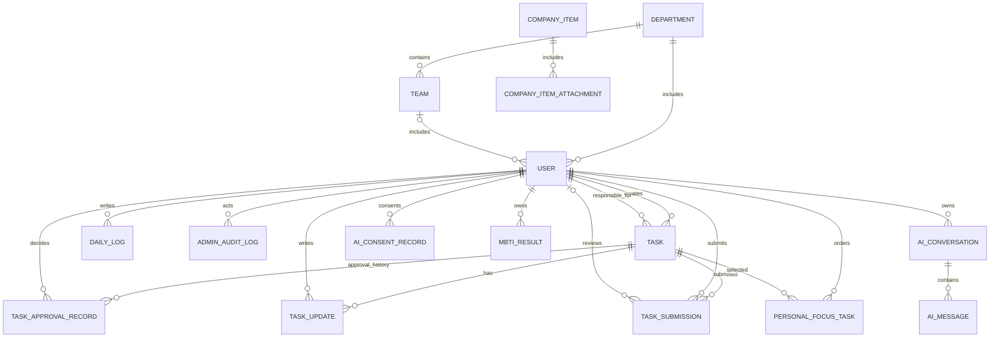

# 后端数据库设计

## Issue #6 已落地的数据模型

本节是本次迁移的真实结构，后文其余模块仍为目标设计。初始化与旧数据库升级见 [账号录入契约](account-provisioning.md)。

| 实体/表 | 字段和关系 |
| --- | --- |
| User / accounts_user | 保留 AbstractUser 字段；username 全局唯一、password 仅存 Django 哈希、display_name 最长 100；account_type 为 admin/business；business_role 为 founder/department_manager/team_leader/employee（管理员为空字符串）；department_id、team_id、manager_id 可空外键；is_active 沿用 Django 字段 |
| Department / accounts_department | id BigAutoField；name 最长 100 且全局唯一；description 文本默认空；created_at 自动时间 |
| Team / accounts_team | id BigAutoField；name 最长 100；description 默认空；department_id 必填外键；created_at 自动时间；(department_id, name) 唯一 |

用户和组织外键均为 PROTECT，manager_id 自关联 User，反向 direct_reports；本次没有删除 API。数据库 CHECK 校验账号类型与角色组织形状：管理员/创始人没有组织和上级，部门经理有部门/上级无团队，团队长/员工有部门、团队和上级。数据库条件唯一约束保证一位在职创始人、一部门一在职经理、一团队一在职团队长；唯一约束和录入重复校验都过滤 `is_active=True`，停用账号不占用名额。跨表的团队部门一致、上级身份/组织和启用状态由服务端录入校验，manager_id 不接收客户端输入。业务账号不会自动获得 Django staff/superuser 权限。

本次没有组织 status、负责人替换/停用工作流、审计表。下文的 status、审计、调动历史和其它业务实体不能视为已落地。当前 SQLite 支持条件唯一约束；未来 MySQL 迁移必须先重新设计等价约束并验证，不能直接假定条件索引可用。0002 对已有普通账号会停止迁移，要求显式规划身份数据迁移，不会自动提升权限；0003 将创始人/部门经理/团队长唯一约束改为仅对 `is_active=True` 生效。

> 维护说明：由项目统筹与后端同学共同维护，作为数据库设计的持续文档。本文描述逻辑模型，字段、类型、索引及历史策略可随实现和需求协商调整。  
> 当前后端使用 SQLite 开发；下表按 Django ORM 可实现、未来可迁移 MySQL 的关系模型设计。  
> 依据：`docs/requirements/01` 至 `06`。数据库设计与最新确认的需求保持一致。

## 1. 设计原则

- 一个任务只有一个创建人和一个负责人；任务关联说明是自由文本，不建立任务父子关系。
- 任务审批状态、完成状态和取消生命周期分开存储；进展以追加说明记录，不保存百分比。
- 管理端只维护组织/账号/公司重要事项/审计数据，不管理任务和员工日志。
- 固定业务角色使用用户字段枚举和服务端权限规则；MVP 不另建 `Role`、`Permission`、`UserRole`、`RolePermission` 多张业务权限表。需要管理端菜单权限时优先使用 Django `Group`/`Permission`。
- 日志按用户及自然日唯一；不存在“未填写”日志行，未填写由无记录表示。
- 工作视图是任务、动态记录的查询投影，不单独复制存储日/周/月日历数据。
- 以下字段类型使用逻辑名称；最终以 Django 字段、数据库引擎和迁移文件为准。金额、地理位置等无关字段不预留。

## 2. 实体关系概览

图中 `USER` 是业务用户的逻辑实体；管理员是否复用同一 Django 用户表仍待定。若采用独立管理员表，`ADMIN_AUDIT_LOG.actor_id` 应改为指向管理员表，不能混用身份。

## 3. 核心表结构

### 3.1 用户、部门与团队

当前代码已有 `accounts.User(AbstractUser)`，实际只额外增加了 `display_name`；下列业务组织字段为拟议扩展，尚未落地。

#### `accounts_user`（Django 自定义用户表）

| 字段 | 类型 / 约束 | 说明 |
|---|---|---|
| `id` | 主键 | 用户 ID |
| `username` | 唯一字符串 | 登录账号；继承 Django `AbstractUser` |
| `password` | 哈希字符串 | Django 密码哈希，不存明文 |
| `display_name` | 字符串，必填 | 姓名/显示名称；当前模型允许空，正式账号建议必填 |
| `account_type` | 枚举 | `business` / `admin`；若拆分认证模型则无需该列 |
| `business_role` | 可空枚举 | `founder`、`department_manager`、`team_leader`、`employee`；管理员账号为空 |
| `department_id` | 可空外键 | 业务用户所属部门 |
| `team_id` | 可空外键 | 所属团队；需与部门归属一致 |
| `manager_id` | 可空自关联外键 | 直属上级；用于审批和下属范围，组织变更规则需明确 |
| `is_active` | 布尔值 | 启用/停用账号；停用不物理删除 |
| `date_joined` | 时间 | 创建/加入时间，继承字段 |
| `created_at`, `updated_at` | 时间 | 业务资料创建、修改时间 |

约束：业务角色为单一主角色；负责人必须是自己或符合当前派发规则的下属。创始人无上级审批。不要将 Django `is_staff` 与业务角色混为一谈。若把管理员和业务用户拆成独立模型，登录名唯一范围、密码重置和审计外键需一并调整。

#### `organization_department`

| 字段 | 类型 / 约束 | 说明 |
|---|---|---|
| `id` | 主键 | 部门 ID |
| `name` | 字符串，唯一 | 部门名称 |
| `description` | 可空文本 | 说明 |
| `status` | 枚举 | `active` / `inactive` |
| `created_at`, `updated_at` | 时间 | 维护时间 |

#### `organization_team`

| 字段 | 类型 / 约束 | 说明 |
|---|---|---|
| `id` | 主键 | 团队 ID |
| `department_id` | 外键，必填 | 所属部门 |
| `name` | 字符串 | 团队名称；是否要求部门内唯一待实现时确定 |
| `description` | 可空文本 | 说明 |
| `status` | 枚举 | `active` / `inactive` |
| `created_at`, `updated_at` | 时间 | 维护时间 |

停用组织前校验没有启用的下级组织或成员；组织与账号采用停用保留历史，不物理删除。是否需要独立组织调动历史表待定。

### 3.2 任务与处理记录

#### `tasks_task`

| 字段 | 类型 / 约束 | 说明 |
|---|---|---|
| `id` | 主键 | 任务 ID |
| `creator_id` | 用户外键，必填 | 创建人 |
| `assignee_id` | 用户外键，必填 | 唯一负责人 |
| `title` | 字符串，必填 | 任务标题 |
| `description` | 文本，必填 | 任务详情 |
| `required_materials` | 可空文本 | 完成时应提交的材料说明，不代表附件 |
| `association_note` | 可空文本 | 与其他工作/上级任务的注释型关联，不设 `parent_task_id` |
| `is_cross_department` | 布尔值 | 是否通过跨部门专用入口创建；仅供筛选，普通接口不可任意设置 |
| `creator_department_id` | 可空外键/快照 | 创建时部门，便于审计；当前权限是否用快照待定 |
| `assignee_department_id` | 可空外键/快照 | 派发时负责人部门，便于跨部门识别 |
| `due_at` | 带时区时间，必填 | 截止时间 |
| `approval_status` | 枚举 | `pending` / `returned` / `approved` |
| `completion_status` | 枚举 | `unfinished` / `completed`，业务完成状态仅两种 |
| `lifecycle_status` | 枚举 | `active` / `cancelled`，取消不是完成 |
| `completed_at` | 可空时间 | 验收通过或自我负责任务提交即完成的时间 |
| `cancelled_at` | 可空时间 | 取消时间 |
| `cancellation_reason` | 可空文本 | 创建人取消原因 |
| `created_at`, `updated_at` | 时间 | 创建与最近修改时间 |

不设优先级、百分比进度、多负责人字段或物理父子任务外键。`is_cross_department` 应由跨部门创建服务端点产生并校验。任务创建/关键定义编辑/截止时间历史是否需要完整版本留痕，建议先纳入审计策略确认。

#### `tasks_approval_record`

| 字段 | 类型 / 约束 | 说明 |
|---|---|---|
| `id` | 主键 | 审批记录 ID |
| `task_id` | 外键 | 对应任务 |
| `round` | 正整数 | 审批轮次，任务重提时递增 |
| `approver_id` | 用户外键 | 应审批的直属上级；跨部门入口可为创始人 |
| `decision` | 枚举 | `approved` / `returned` |
| `comment` | 文本 | 退回时必填说明；通过说明可选 |
| `decided_at` | 时间 | 审批时间 |
| `created_at` | 时间 | 该轮审批请求时间 |

每次提交审批追加记录，不覆盖既有决定。唯一约束建议为 `(task_id, round)`。待审批任务需由服务层保证只被正确审批人处理。

#### `tasks_task_update`

| 字段 | 类型 / 约束 | 说明 |
|---|---|---|
| `id` | 主键 | 动态 ID |
| `task_id` | 外键 | 对应任务 |
| `author_id` | 用户外键 | 负责人 |
| `content` | 文本，必填 | 本次进展说明 |
| `created_at` | 时间 | 更新发生时间 |

记录只追加，不保存百分比进度；作为周/日视图的“任务更新”动态来源。

#### `tasks_task_submission`

| 字段 | 类型 / 约束 | 说明 |
|---|---|---|
| `id` | 主键 | 提交记录 ID |
| `task_id` | 外键 | 对应任务 |
| `submitted_by_id` | 用户外键 | 负责人 |
| `completion_note` | 文本，必填 | 完成说明 |
| `materials_note` | 可空文本 | 已提交材料的文字说明；MVP 暂无附件上传 |
| `review_status` | 枚举 | `waiting` / `returned` / `accepted` / `self_completed` |
| `reviewed_by_id` | 可空用户外键 | 直接派发者；自我完成时为空 |
| `review_comment` | 可空文本 | 退回原因/验收意见 |
| `submitted_at` | 时间 | 提交时间 |
| `reviewed_at` | 可空时间 | 验收或退回时间 |

每次重新提交新增一条记录，历史提交保留。直接派发者验收通过时把任务 `completion_status` 置为 `completed`；提交人与负责人相同时，在同一事务中记为 `self_completed` 并完成任务，不产生自我验收。

### 3.3 首页重点任务与公司重要事项

#### `home_personal_focus_task`

| 字段 | 类型 / 约束 | 说明 |
|---|---|---|
| `id` | 主键 | 记录 ID |
| `user_id` | 用户外键 | 任务列表所属用户 |
| `task_id` | 任务外键 | 被选入个人重点的任务 |
| `sort_order` | 正整数 | 拖拽顺序 |
| `created_at`, `updated_at` | 时间 | 选择和排序时间 |

唯一约束 `(user_id, task_id)`；服务层限制每人最多 10 条，且仅能选择本人承担的未完成任务。任务完成、取消或转派后移除或从查询中排除。公司十大重要任务由任务数据动态计算，不另建排行榜表。

#### `content_company_item`

| 字段 | 类型 / 约束 | 说明 |
|---|---|---|
| `id` | 主键 | 事项 ID |
| `title` | 字符串，必填 | 标题 |
| `summary` | 可空短文本 | 首页摘要 |
| `body` | 文本，必填 | 详情 |
| `status` | 枚举 | `draft` / `published` / `offline` |
| `sort_order` | 整数 | 手动排序 |
| `publisher_id` | 管理员/用户外键 | 发布人 |
| `published_at` | 可空时间 | 发布时间 |
| `created_at`, `updated_at` | 时间 | 创建、编辑时间 |

发布事项总数最多 10 条；不设置置顶。首页按已发布状态和手动顺序取最多 5 条，二级页展示全部已发布事项。

#### `content_company_item_attachment`（可选）

| 字段 | 类型 / 约束 | 说明 |
|---|---|---|
| `id` | 主键 | 附件 ID |
| `company_item_id` | 外键 | 所属事项 |
| `file_key` | 字符串 | 存储键/相对路径，不建议把大文件二进制塞进关系表 |
| `original_name` | 字符串 | 上传时文件名 |
| `mime_type`, `size_bytes` | 字符串/整数 | 类型及大小 |
| `uploaded_at` | 时间 | 上传时间 |

附件实际存储（本地、对象存储等）、大小限制和清理策略待定；该表可在附件功能明确后再实现。

### 3.4 工作日志

#### `logs_daily_log`

| 字段 | 类型 / 约束 | 说明 |
|---|---|---|
| `id` | 主键 | 日志 ID |
| `author_id` | 用户外键 | 作者 |
| `log_date` | 日期 | 日志自然日 |
| `completed_work` | 文本，必填 | 今日完成工作 |
| `next_day_plan` | 可空文本 | 下一步/明日计划 |
| `status` | 枚举 | `draft` / `submitted` |
| `department_id`, `team_id` | 可空外键/快照 | 写日志时的组织归属；历史授权口径待确认 |
| `created_at`, `updated_at` | 时间 | 创建和最后修改时间 |
| `submitted_at` | 可空时间 | 提交时间 |

唯一约束 `(author_id, log_date)`。未填写日志不建记录，不设 `missing` 状态。提交后在自然日结束前可修改，之后只读；历史日志不允许作者回改。MVP 不存任务关联、问题风险、附件或内容搜索字段，也不存管理者评价。

### 3.5 审计与 AI

#### `admin_audit_log`

| 字段 | 类型 / 约束 | 说明 |
|---|---|---|
| `id` | 主键 | 审计记录 ID |
| `actor_id` | 管理员外键 | 执行管理操作的账号 |
| `module` | 字符串/枚举 | `users`、`organization`、`company_items` 等 |
| `action` | 字符串 | 创建、修改、停用、发布等 |
| `object_type`, `object_id` | 字符串 | 被操作对象类型和 ID |
| `result` | 枚举 | `success` / `failure` |
| `before_data`, `after_data` | JSON，可空 | 变更前后摘要；敏感字段必须脱敏 |
| `created_at` | 时间 | 操作时间 |

只记录管理端组织/账号/事项等操作；不在审计内容中保存密码、令牌、AI 私密对话正文或完整日志正文。按时间/管理员/模块索引；按需求暂不自动清理。

#### `ai_consent_record`

| 字段 | 类型 / 约束 | 说明 |
|---|---|---|
| `id` | 主键 | 授权记录 ID |
| `user_id` | 用户外键 | 用户 |
| `policy_version` | 字符串 | 同意的数据处理说明版本 |
| `consented_at` | 时间 | 明确同意时间 |
| `withdrawn_at` | 可空时间 | 撤回授权时间（撤回流程待确定） |

#### `ai_conversation` 与 `ai_message`

`ai_conversation` 保存 `id`、`user_id`、`type`（`work`/`treehole`）、`title`、`created_at`、`updated_at`、`deleted_at`（或直接级联物理删除）。`ai_message` 保存 `id`、`conversation_id`、`role`（`user`/`assistant`/`system`）、`content`、`status`、`created_at`。会话按用户隔离；树洞与工作助手不能共享上下文；删除会话后消息不再可查询或提供给后续模型上下文。具体合规留存与软/硬删除需确认。

工作助手如需保存用户明确选择的参考资料，可增加 `ai_conversation_reference(conversation_id, resource_type, resource_id)`，仅允许引用该用户自己的任务或已提交日志；不要将业务数据全文重复复制到 AI 表。树洞会话禁止引用业务数据。

#### `ai_mbti_result`

保存 `id`、`user_id`（唯一，保证只保留最新结果）、`questionnaire_version`、`answers_json`、`result_code`、`completed_at`。重测更新最新记录。结果仅本人可见，不向上级或管理员提供查询接口。轻量问答题目和计分配置是否需要独立题库表待定；首版可配置在代码/版本化数据中。

## 4. 工作视图动态的存储方式

月/周/日视图不设独立的 `calendar_event` 或“日历任务副本”表：

- 未完成任务全天条来自 `tasks_task` 的负责人、截止时间及完成/取消状态。
- 月视图的历史完成态由 `completed_at`、任务动态及所选自然日推导。若允许修改标题/截止时间后仍需还原历史视图，应增加任务字段变更历史表，单靠当前任务行无法还原。
- 周/日时间轴的任务更新来自 `tasks_task_update`；提交和验收来自 `tasks_task_submission`，按发生时间合并排序。自我负责任务产生一条 `self_completed` 记录。
- 审批记录不展示为负责人任务视图动态，除非后续需求明确添加。

因此历史月视图是否需要完整还原历史标题/截止日期、取消任务在历史视图的显示、任务重复提交动态如何呈现，需要在实现视图查询前明确；必要时增加统一只追加的 `task_event` 或 `task_change_history`。

## 5. 索引与约束建议

- 用户：`username` 唯一；按 `(department_id, team_id, business_role, is_active)` 查询组织成员；`manager_id` 索引。
- 任务：`(assignee_id, approval_status, completion_status, lifecycle_status, due_at)`、`(creator_id, approval_status, created_at)`、`(is_cross_department, created_at)`；`due_at` 必填。
- 审批：`(approver_id, decision, created_at)`、`(task_id, round)` 唯一。
- 任务动态/提交：`(task_id, created_at)`、`(task_id, submitted_at)`；按需对负责人和事件时间增加索引。
- 日志：`(author_id, log_date)` 唯一；`(department_id, log_date)`、`(team_id, log_date)` 用于授权范围查询。
- 个人重点：`(user_id, sort_order)` 索引、`(user_id, task_id)` 唯一。
- 公司事项：`(status, sort_order)`；发布上限 10 由事务/服务层校验，不能只依赖单行约束。
- JSON 字段只用于确有动态结构的数据（审计快照、问卷答案），核心业务查询字段应保持关系列。
- 对 `User`、组织、已引用审计对象采用停用或保护删除；对个人 AI 会话的删除按隐私和留存政策另行设计。

## 6. 尚待确认

1. 管理账号是否与业务用户共用认证表；`business_role`、直属上级的最终组织模型，以及一个部门经理直接管理哪些岗位。
2. 组织调动后任务/日志授权按当前组织树还是创建时快照；是否需要组织调动历史表。
3. 已批准任务关键字段变更后“重新审批”的版本快照如何保存；退回后是否原任务修改重提，或另开审批轮次。
4. 取消任务的列表/历史可见规则，以及任务取消和历史日历条的关系。
5. 月视图历史状态是否只需还原完成态，还是还需还原标题、截止日期等字段历史。
6. 管理员审计快照保留期限与脱敏细则；公司事项附件存储；AI 对话/授权数据的删除和供应商留存策略。
7. MBTI 题目、计分、结果保存最小化要求；业务数据在 SQLite 到 MySQL 迁移时的字符集、主键策略和迁移窗口。

## 7. 实施顺序建议

先冻结 `User` 与组织归属模型，再建立任务、审批、进展、提交记录，随后建设日志和首页重点任务；管理后台组织/账号数据需早于业务端账号联调。AI、附件和完整历史版本可按需求确认结果后再补，不应阻塞首批账号、任务主链路和日志 API。
