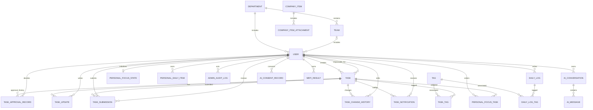

# 后端数据库设计

## Issue #20 后端已落地的数据模型

`logs_dailylog` 保存作者、日志日期、写入时的部门/团队、今日完成、明日计划、草稿/已提交状态与创建、更新、提交时间；数据库约束 `(author_id, log_date)` 唯一。`logs_dailylogcomment` 独立保存日志评论、评论人和创建时间，不改变日志正文或更新时间；评论人与日志作者相同时由查询响应标记“日志本人”。`tags_tag` 保存名称、当前标签颜色、启用状态及时间戳，并以 SQLite 条件唯一约束保证启用名称唯一。`logs_dailylogtag` 以独立关系行保存日志和标签、添加时间，`(daily_log_id, tag_id)` 唯一；停用标签不解除历史关联。日志、评论和关系实体由迁移建立，评论表由 `logs/0002_dailylogcomment` 添加。业务服务校验近三自然日写入、草稿隐私、组织查看范围及停用标签只能保留已有关系。未来改用 MySQL 时，须为启用标签名称设计等价的数据库唯一约束；MySQL 不直接支持当前的条件唯一索引语义。

## Issue #21 后端已落地的数据模型

`tasks_task` 保存任务定义、创建人/负责人、创建与派发部门快照、预计开始时间、截止时间、三个独立状态维度及完成/取消时间；内部 `returned_edit_required` 字段确保审批退回后必须先实际修改再重提。`tasks_taskapprovalrecord` 以 `(task_id, round)` 唯一约束保存每轮直属上级审批；`tasks_taskupdate` 和 `tasks_tasksubmission` 保存只追加文字进展及每次完成提交/验收；`tasks_taskchangehistory` 保存任务创建与定义修改的字段差异；`tasks_tasknotification` 使用唯一 `event_key` 保存审批请求、审批结果、派发、取消及提交/验收通知，通知流程结束时间与已读状态分开保存，并按接收人/已读/创建时间建索引。`tags_tasktag` 保存任务与标签关系及首次关联时间，`(task_id, tag_id)` 唯一。任务实体由 `tasks/0001_initial` 创建，通知生命周期字段由 `tasks/0002_task_notification_lifecycle` 扩展，预计开始字段和时间约束由 `tasks/0004_task_estimated_start_at_and_more` 添加；`tasks/0005_alter_tasknotification_notification_type` 更新通知类型 choices，不改变表结构或既有通知数据。任务标签关联因迁移依赖关系由 `tags/0002` 和 `tags/0003` 创建。无任务树、进度百分比、实际开始时间、跨部门任务类型或通知推送实体。当前使用 SQLite；正式迁移 MySQL 前须验证迁移和索引语义。

## Issue #22 后端已落地的数据模型

`content_company_item` 保存标题、摘要、正文、`draft/published/offline` 状态、手动顺序、发布人与发布/下线时间及最近一次下线原因（重新发布时清空），索引 `(status, sort_order)`；发布上限 10 条由服务层在事务内校验（SQLite 下靠单写入者，MySQL 下对已发布行加锁）。`content_company_item_attachment` 只保存文件引用与元数据（`file_key`、`original_name`、`mime_type`、`size_bytes`），开发期文件落在 `MEDIA_ROOT`，不把二进制写入关系表。该表及管理端上传/删除接口在后端保留；当前 App 公司事项流程只在列表内折叠/展开正文，不进入独立详情页，也不展示或下载附件。后续若确认增加公司事项详情页或附件上传/下载，应另行补充客户端需求与接口契约。任务模块目前仅有材料文字说明字段，不包含任务附件；若后续需要任务附件，应在任务模块单独定义。`home_personal_focus_task` 保存用户自选的任务顺序，`(user_id, task_id)` 与 `(user_id, sort_order)` 唯一；`home_personal_focus_state` 以一对一保存首次预填时间。首页其余三个面板直接读取 `content_company_item`、`tasks_task` 与 `logs_daily_log`，不另建摘要表；`AdminAuditLog.module` 扩展 `company_items` 记录事项创建、编辑、发布、下线、排序与附件操作。管理端事项接口写审计，App 端全部只读。

## Issue #8 已落地数据模型：个人每日事项

`home_personaldailyitem` 由 `home/0002_homepersonaldailyitem` 创建，是员工本人创建的个人备忘录，独立于 `tasks_task`、`logs_daily_log`、标签关系表和操作审计表。每条记录保存标题、包含首尾日期的起止范围、选填说明和从标签系统十色调色板中选择的颜色。数据库约束保证结束日不早于开始日且颜色属于预设色板；按 `(owner_id, start_date)` 和 `(owner_id, end_date)` 建索引。创建、编辑、拖动和删除均不生成 App 或 Web 审计记录。首页通过该表按当前用户和业务时区的今天日期读取最多五条摘要；个人月历按可见日期范围读取所有相交事项。

需求 09 取代首页原“个人十大重点工作”面板。既有 `home_personal_focus_task`、`home_personal_focus_state` 及对应接口不转换成每日事项，也不在本 change 中物理删除；迁移期保留旧数据和旧接口以兼容旧 App，新的每日事项页面不读取或写入这些表。后续若要清理旧功能，另行确定版本兼容和数据保留方案。

## Issue #6 已落地的数据模型

本节记录 Issue #6 已落地及 Issue1 账号创建对齐后的真实结构，后文其余模块仍为目标设计。初始化与旧数据库升级见 [账号录入契约](account-provisioning.md)。

| 实体/表 | 字段和关系 |
| --- | --- |
| User / accounts_user | 保留 AbstractUser 字段；username 全局唯一（业务账号保存手机号，管理员保留管理员用户名）、password 仅存 Django 哈希、display_name 最长 100；id_number 使用加密文本字段并允许历史记录暂空，保存前去除首尾空格并将字母转为大写；id_number_hash 为规范化后 id_number 的 HMAC-SHA256 哈希并全局唯一（包括停用账号；密钥由服务器保管；加密字段无法按明文做数据库唯一约束，故用带密钥的确定性哈希保证身份证号唯一）；account_type 为 admin/business；business_role 为 founder/department_manager/team_leader/employee（管理员为空字符串）；department_id、team_id、manager_id 可空外键；is_active 沿用 Django 字段 |
| Department / accounts_department | id BigAutoField；name 最长 100 且全局唯一；description 文本默认空；is_active 布尔默认启用；created_at、updated_at 自动时间 |
| Team / accounts_team | id BigAutoField；name 最长 100；description 默认空；department_id 必填外键；is_active 布尔默认启用；created_at、updated_at 自动时间；(department_id, name) 唯一 |
| AdminAuditLog / accounts_adminauditlog | id BigAutoField；actor 外键 User（PROTECT）；module（users/departments/teams/company_items）；action；object_type、object_id；result（success/failure）；before_data、after_data（JSON，脱敏后）；created_at 自动时间 |
| AppOperationAuditLog / accounts_appoperationauditlog | 员工 App 成功登录和成功写操作的独立审计表；操作者及组织快照、目标对象快照、变更字段和修改前后业务值；不与 AdminAuditLog 混用 |

User 另有 `avatar_data`（可空二进制）、`avatar_content_type`（检测后的 MIME 类型）和 `avatar_updated_at` 字段。头像上传后直接保存在 `accounts_user` 行中，不使用服务器媒体文件目录；App 用户只能写入自己的头像，但可以通过组织关系查看启用业务成员的头像。迁移 `0011_user_profile_avatar` 为现有账号新增空头像字段，不影响已有资料。

用户和组织外键均为 PROTECT，manager_id 自关联 User，反向 direct_reports；本次没有删除 API。数据库 CHECK 校验账号类型与角色组织形状：管理员/创始人没有组织和上级，部门经理有部门无团队，团队长/员工有部门和团队；`manager_id` 允许为空以支持负责人空缺，并通过 `user_cannot_manage_self` CHECK 禁止用户将自己设为直属上级。数据库条件唯一约束保证最多一位启用创始人、一部门一名启用经理、一团队一名启用团队长；允许暂时没有启用负责人，停用账号不占用名额。跨表的团队部门一致、上级身份/组织和启用状态由服务端校验，manager_id 不接收客户端输入。负责人链不完整时，后端拒绝受影响业务用户登录、刷新令牌及访问 App API；管理员 Web 管理接口不受影响。业务账号不会自动获得 Django staff/superuser 权限。

Issue #15（Issue2）已落地：部门/团队 `is_active` 启停（停用前校验无启用的下属团队/成员）、员工身份/组织调整（仅 `business_role`/`department_id`/`team_id`/`is_active`）、App 个人资料与密码、`AdminAuditLog` 审计（`before_data`/`after_data` 已脱敏，不含明文密码或完整身份证号）。负责人空缺期间，直属下属的 `manager_id` 可暂时为空；补齐负责人后由服务端恢复直接关系，链路缺失时 App 暂停访问。组织调动历史表不在 Issue2 范围内。当前 SQLite 支持条件唯一约束；未来 MySQL 迁移必须先重新设计等价约束并验证，不能直接假定条件索引可用。0002 对已有普通账号会停止迁移，要求显式规划身份数据迁移，不会自动提升权限；0003 将创始人/部门经理/团队长唯一约束改为仅对 `is_active=True` 生效；0004 增加可空的加密 `id_number` 字段；0005 增加组织 `is_active` 与 `AdminAuditLog`；0006 增加 `id_number_hash` 唯一列；0007 增加 `updated_at` 并放松 placement 约束允许 `manager_id` 为空；0008 在写入前检查历史身份证号重复值并回填 `id_number_hash`，反向迁移保留哈希；0009 检查历史自我上级记录并增加禁止自我上级的数据库约束；0010 在写入规范化结果前检查大小写/空格规范化后的历史身份证号重复值，并规范化身份证号及其唯一哈希。

`id_number` 由自定义 `EncryptedTextField` 以 Fernet token 加密后写入数据库；应用进程通过 `IDENTITY_NUMBER_ENCRYPTION_KEY` 环境变量读取独立密钥。生产环境必须配置并妥善备份该密钥；密钥丢失后，已存储的身份证号将无法解密。开发环境在 `DEBUG=True` 且未配置独立密钥时，使用开发 `SECRET_KEY` 派生密钥。

> 维护说明：由项目统筹与后端同学共同维护，作为数据库设计的持续文档。本文描述逻辑模型，字段、类型、索引及历史策略可随实现和需求协商调整。  
> 当前后端使用 SQLite 开发；下表按 Django ORM 可实现、未来可迁移 MySQL 的关系模型设计。  
> 依据：`docs/requirements/01` 至 `09`。数据库设计与最新确认的需求保持一致。

## 1. 设计原则

- 一个任务只有一个创建人和一个负责人；任务关联说明是自由文本，不建立任务父子关系。
- 任务审批状态、完成状态和取消生命周期分开存储；进展以追加说明记录，不保存百分比。
- 管理端只维护组织/账号/公司重要事项/审计数据，不管理任务和员工日志。
- 固定业务角色使用用户字段枚举和服务端权限规则；MVP 不另建 `Role`、`Permission`、`UserRole`、`RolePermission` 多张业务权限表。需要管理端菜单权限时优先使用 Django `Group`/`Permission`。
- 日志按用户及自然日唯一；不存在“未填写”日志行，未填写由无记录表示。
- 任务与日志通过独立多对多关系表关联标签；停用标签保留记录和历史关系，不物理删除。
- 工作视图是任务、动态记录的查询投影，不单独复制存储日/周/月日历数据。
- 以下字段类型使用逻辑名称；最终以 Django 字段、数据库引擎和迁移文件为准。金额、地理位置等无关字段不预留。

## 2. 实体关系概览

图中 `USER` 是业务用户的逻辑实体；管理员是否复用同一 Django 用户表仍待定。若采用独立管理员表，`ADMIN_AUDIT_LOG.actor_id` 应改为指向管理员表，不能混用身份。

## 3. 核心表结构

### 3.1 用户、部门与团队

Issue #6 已落地的用户、部门和团队结构见本文件开头的实际模型摘要。下表用于记录业务关系；Issue2 尚未实现的字段和约束会明确标记为目标，不能据此认为迁移已完成。

#### `accounts_user`（Django 自定义用户表）

| 字段 | 类型 / 约束 | 说明 |
|---|---|---|
| `id` | 主键 | 用户 ID |
| `username` | 唯一字符串 | 唯一登录标识；管理员账号保留管理员用户名，业务账号保存手机号 |
| `password` | 哈希字符串 | Django 密码哈希，不存明文 |
| `display_name` | 字符串 | 姓名/显示名称；创建业务账号时必填 |
| `id_number` | 加密文本（Issue1 账号创建对齐已实现） | 加密后持久化；新建业务账号由 API 强制必填；历史账号可在经核实的补录期间暂空；员工可通过 App 更新本人姓名和身份证号；完整值不得出现在普通列表、App 资料读取、日志或审计响应中 |
| `account_type` | 枚举 | `business` / `admin`；若拆分认证模型则无需该列 |
| `business_role` | 可空枚举 | `founder`、`department_manager`、`team_leader`、`employee`；管理员账号为空 |
| `department_id` | 可空外键 | 业务用户所属部门 |
| `team_id` | 可空外键 | 所属团队；需与部门归属一致 |
| `manager_id` | 可空自关联外键 | 直属上级；负责人空缺或变更过渡期间允许为空；由服务端按当前身份与组织关系维护 |
| `avatar_data`, `avatar_content_type` | 可空二进制、MIME 字符串 | App 本人头像内容和检测出的类型；直接存储于数据库，所有登录设备读取同一账号资料 |
| `avatar_updated_at` | 可空时间 | 头像最后上传/替换时间 |
| `is_active` | 布尔值 | 启用/停用账号；新建业务账号自动启用；停用不物理删除 |
| `date_joined` | 时间 | 创建/加入时间，继承字段 |
| `created_at`, `updated_at` | 时间 | 业务资料创建、修改时间 |

头像列由迁移 `0011_user_profile_avatar` 添加；现有账号头像字段为空，不生成默认图片或回填本机文件。业务角色为单一主角色，且与部门/团队归属联动校验。公司最多一名启用创始人、每个部门最多一名启用部门经理、每个团队最多一名启用团队长，均允许暂时没有启用负责人；负责人由用户的业务角色和组织归属推导，不在部门或团队上增加重复负责人外键。负责人撤销或停用后，受影响的直接下属可暂时没有 `manager_id`；新负责人被创建、启用或任命后由服务端重建其直属关系。普通成员只能转入直属负责人已启用的目标组织。不要将 Django `is_staff` 与业务角色混为一谈。`username` 仍全局唯一，不另增重复的账号或手机号字段。

#### `organization_department`

| 字段 | 类型 / 约束 | 说明 |
|---|---|---|
| `id` | 主键 | 部门 ID |
| `name` | 字符串，唯一 | 部门名称 |
| `description` | 可空文本 | 说明 |
| `is_active` | 布尔值 | 部门启用/停用；新部门默认启用 |
| `created_at`, `updated_at` | 时间 | 创建及最近维护时间 |

#### `organization_team`

| 字段 | 类型 / 约束 | 说明 |
|---|---|---|
| `id` | 主键 | 团队 ID |
| `department_id` | 外键，必填 | 所属部门 |
| `name` | 字符串 | 团队名称；在同一部门内唯一 |
| `description` | 可空文本 | 说明 |
| `is_active` | 布尔值 | 团队启用/停用；新团队默认启用 |
| `created_at`, `updated_at` | 时间 | 创建及最近维护时间 |

团队启用时所属部门必须处于启用状态；部门停用时不允许重新启用其下属团队。

Issue2 组织约束（已实现）：部门停用前不得存在启用的下属团队或成员；团队停用前不得存在启用成员。停用对象保留在管理列表中供查看和重新启用，但不作为员工转移或身份分配的候选项。团队归属部门只在创建时设置，Issue2 不提供迁移团队所属部门的操作。组织与账号采用停用保留历史，不物理删除；本次不新增组织调动历史表。

Issue2 已调整用户角色/组织约束，使负责人撤销或停用后的过渡状态可存在：部门经理、团队长和员工的 `manager_id` 可在负责人空缺期间暂时为空；服务端在新负责人有效启用后重建直属关系。每部门最多一名启用部门经理、每团队最多一名启用团队长，沿用针对 `is_active=True` 的条件唯一约束。App 更新 `display_name` 与 `id_number` 可同次提交；字段分别校验，但必须在同一个数据库事务中保存，任一字段校验失败时回滚整次更新。密码修改仅更新现有 `User.password` 哈希字段，不新增密码实体或明文存储字段。

身份证号比较前统一去除首尾空格并将字母转为大写；数据库中加密保存的身份证号也以该形式规范化，HMAC 唯一列对规范化值计算。迁移 0010 在回写前检查规范化后重复的历史记录，只报告账号 ID；若发现重复，需先核对并处理对应账号再重试。

### 3.2 任务与处理记录

#### `tasks_task`

| 字段 | 类型 / 约束 | 说明 |
|---|---|---|
| `id` | 主键 | 任务 ID |
| `creator_id` | 用户外键，必填 | 创建人 |
| `assignee_id` | 用户外键，必填 | 唯一负责人 |
| `title` | 字符串，必填 | 任务标题 |
| `description` | 文本，必填 | 任务详情 |
| `required_materials` | 可空文本 | 完成时应提交的材料说明，不代表附件 |
| `association_note` | 可空文本 | 与其他工作/上级任务的注释型关联，不设 `parent_task_id` |
| `creator_department_id` | 可空外键/快照 | 创建时部门快照，用于历史审计；不作为任务类型标记 |
| `assignee_department_id` | 可空外键/快照 | 派发时负责人部门快照，用于历史审计；不作为任务类型标记 |
| `estimated_start_at` | 可空带时区时间 | 计划开始时间；如填写，不得晚于截止时间；不代表实际开始 |
| `due_at` | 带时区时间，必填 | 截止时间 |
| `approval_status` | 枚举 | `pending` / `returned` / `approved` |
| `completion_status` | 枚举 | `unfinished` / `completed`，业务完成状态仅两种 |
| `lifecycle_status` | 枚举 | `active` / `cancelled`，取消不是完成 |
| `completed_at` | 可空时间 | 验收通过或自我负责任务提交即完成的时间 |
| `cancelled_at` | 可空时间 | 取消时间 |
| `cancellation_reason` | 可空文本 | 创建人取消原因 |
| `created_at`, `updated_at` | 时间 | 创建与最近修改时间 |

不设优先级、百分比进度、多负责人字段、单独开始状态或实际开始时间、物理父子任务外键或跨部门类型字段。预计开始时间为可空的计划字段；数据库约束和接口校验确保其不晚于 `due_at`。负责人范围由统一任务创建服务按创建人角色和组织关系校验；部门经理可指派给其他部门经理，且仍走创建人的直属上级审批。部门快照仅用于保留创建/派发时的组织上下文，不用于分类或筛选。任务创建和定义字段修改由 `tasks_task_change_history` 记录操作人、时间及变更前后值；审批、进展、完成提交/验收和取消分别由其专属记录或字段保存。

#### `tasks_task_pin`

| 字段 | 类型 / 约束 | 说明 |
|---|---|---|
| `id` | 主键 | 置顶关系 ID |
| `user_id` | 用户外键，必填 | 置顶该任务的 App 账号 |
| `task_id` | 任务外键，必填 | 被置顶的任务；物理删除任务时级联清理置顶关系 |
| `pinned_at` | 时间 | 最近置顶时间，用于置顶区倒序排列 |

唯一约束 `(user_id, task_id)`，同一账号对同一任务仅保留一条置顶关系。仅允许置顶当前账号创建或承担的已审批任务；任务完成或取消后保留置顶关系。该表保存个人展示偏好，不写入任务定义变更历史或 App 操作审计记录。

#### `tasks_approval_record`

| 字段 | 类型 / 约束 | 说明 |
|---|---|---|
| `id` | 主键 | 审批记录 ID |
| `task_id` | 外键 | 对应任务 |
| `round` | 正整数 | 审批轮次，任务重提时递增 |
| `approver_id` | 用户外键 | 应审批的创建人直属上级；创始人创建的任务无需审批 |
| `decision` | 枚举 | `pending` / `approved` / `returned`；新审批轮次从 `pending` 开始 |
| `comment` | 可空文本 | 退回决定必填说明；通过说明可选 |
| `decided_at` | 可空时间 | 作出通过/退回决定的时间；待审批时为空 |
| `created_at` | 时间 | 该轮审批请求时间 |

每次创建或重新提交审批时新增一轮 `pending` 记录；审批完成后将该轮记录更新为 `approved` 或 `returned`，之后不再覆盖已作出的决定。唯一约束 `(task_id, round)`。`approver_id` 固定本轮应审批人，待审批列表不依赖每次查询时重新推导直属上级；服务层保证只有该审批人能处理该轮。

#### `tasks_task_update`

| 字段 | 类型 / 约束 | 说明 |
|---|---|---|
| `id` | 主键 | 动态 ID |
| `task_id` | 外键 | 对应任务 |
| `author_id` | 用户外键 | 负责人 |
| `content` | 文本，必填 | 本次进展说明 |
| `created_at` | 时间 | 更新发生时间 |

记录只追加，不保存百分比进度；作为周/日视图的“任务更新”动态来源。

#### `tasks_task_submission`

| 字段 | 类型 / 约束 | 说明 |
|---|---|---|
| `id` | 主键 | 提交记录 ID |
| `task_id` | 外键 | 对应任务 |
| `submitted_by_id` | 用户外键 | 负责人 |
| `completion_note` | 文本，必填 | 完成说明 |
| `materials_note` | 可空文本 | 已提交材料的文字说明；MVP 暂无附件上传 |
| `review_status` | 枚举 | `waiting` / `returned` / `accepted` / `self_completed` |
| `reviewed_by_id` | 可空用户外键 | 直接派发者；自我完成时为空 |
| `review_comment` | 可空文本 | 退回原因/验收意见 |
| `submitted_at` | 时间 | 提交时间 |
| `reviewed_at` | 可空时间 | 验收或退回时间 |

每次重新提交新增一条记录，历史提交保留。直接派发者验收通过时把任务 `completion_status` 置为 `completed`；提交人与负责人相同时，在同一事务中记为 `self_completed` 并完成任务，不产生自我验收。

#### `tasks_task_change_history`

| 字段 | 类型 / 约束 | 说明 |
|---|---|---|
| `id` | 主键 | 任务定义变更记录 ID |
| `task_id` | 外键，保护删除 | 被修改的任务 |
| `actor_id` | 用户外键，必填 | 执行创建或修改的用户 |
| `change_type` | 枚举 | `created` / `updated` |
| `changes` | JSON | 本次实际变化字段及变更前后值；不重复保存未变更字段 |
| `created_at` | 时间 | 变更发生时间 |

创建任务和每次任务定义修改均追加记录；包含标题、详情、负责人、预计开始时间、截止时间、预期材料、关联说明及标签关联的变更。负责人值按 `{id, display_name}` 保存操作时的员工姓名；标签关联值按关联顺序保存 `{id, name}`，名称同样是操作时快照。既有仅保存数字 ID 的 JSON 记录由读取接口尽可能补充对应名称。该结构使用现有 JSON 字段，不需要数据库迁移。审批决定、进展、完成提交/验收和取消原因分别保存在审批、动态、提交记录及任务当前取消字段中，不在此表重复记录。通过任务详情可见权限控制读取；记录不可由客户端修改或删除。

#### `tasks_task_notification`

| 字段 | 类型 / 约束 | 说明 |
|---|---|---|
| `id` | 主键 | 通知 ID |
| `recipient_id` | 用户外键，必填 | 通知接收人 |
| `task_id` | 外键，保护删除 | 对应任务 |
| `submission_id` | 可空外键，保护删除 | 关联的完成提交；结果提交、验收通过和退回通知关联具体提交记录 |
| `notification_type` | 枚举 | `approval_required` / `approval_approved` / `approval_returned` / `assignment_received` / `task_cancelled` / `submission_received` / `submission_accepted` / `submission_returned` |
| `event_key` | 字符串，必填且唯一 | 业务事件幂等键；待审批和审批结果通知含任务、审批轮次及结果类型，派发通知含通过的审批记录 ID，提交/验收结果通知含提交 ID，取消通知含任务和接收人 ID |
| `is_read` | 布尔值，默认 `false` | 是否已读 |
| `created_at` | 时间 | 通知生成时间 |
| `read_at` | 可空时间 | 标记已读时间 |
| `resolved_at` | 可空时间 | 对应通知已不再需要处理的时间；不代表用户已读 |

`approval_required` 只发给创建人的直属上级，任务进入待本人审批时生成。审批人通过或退回后，系统结束该轮待审批提醒，并向创建人生成 `approval_approved` 或 `approval_returned` 结果事件通知；结果通知通过任务 ID、审批轮次和决定构造唯一事件键，退回通知从该轮审批记录读取原因。创建人结果通知不与后续轮次合并或覆盖，保留在通知历史中直至用户阅读。其他用户创建的任务通过审批并进入负责人的“我的任务”时，向负责人生成派发通知。待审批任务取消时，通知当前待审批人；已审批的他人派发任务取消时，通知负责人。负责人提交完成结果时结束尚未处理的新任务通知，并通知直接派发人；验收通过或退回时通知负责人，重新提交会结束上一次验收退回通知。本人创建并由本人承担的任务不生成派发、提交或验收通知。已结束通知保留在历史记录中，但不再进入未读数和未读筛选；结束状态与已读状态独立；迁移会依据任务当前状态结束已取消、已完成、已改派、已进入其他审批轮次或已有提交记录的旧提醒。每个通知仅对接收人可读，通知列表打开时由客户端将当次页面实际展示的未读 ID 批量标记已读。通知是 App 内消息，不发送操作系统推送。

### 3.3 首页面板与个人每日事项相关数据实体

首页不复制任务、日志、公司事项或每日事项正文数据。公司事项、任务和日志摘要仍分别从权威业务表读取；每日事项摘要直接从 `home_personaldailyitem` 按本人和日期范围查询。下方个人重点表属于被需求 09 替换的旧首页面板，保留用于旧 App 兼容，不供新的每日事项功能使用。

#### `home_personal_focus_task`（旧个人重点功能，兼容保留）

| 字段 | 类型 / 约束 | 说明 |
|---|---|---|
| `id` | 主键 | 记录 ID |
| `user_id` | 用户外键 | 任务列表所属用户 |
| `task_id` | 任务外键 | 被选入个人重点的任务 |
| `sort_order` | 正整数 | 拖拽顺序 |
| `created_at`, `updated_at` | 时间 | 选择和排序时间 |

唯一约束 `(user_id, task_id)` 与 `(user_id, sort_order)`；服务层限制每人最多 10 条，且仅能选择本人承担的未完成任务。任务完成、取消或转派后移除或从查询中排除。任务看版由任务数据动态计算，不另建排行榜表。

#### `home_personal_focus_state`（旧个人重点功能，兼容保留）

| 字段 | 类型 / 约束 | 说明 |
|---|---|---|
| `id` | 主键 | 状态记录 ID |
| `user_id` | 用户外键，一对一 | 个人重点列表所属用户 |
| `initialized_at` | 时间 | 首次预填个人重点列表的时间；不为空时不再自动重建 |
| `created_at`, `updated_at` | 时间 | 状态记录创建和更新时间 |

首次读取或首次保存个人重点列表时，在同一事务中用当时的任务看版初始化最多 10 项，并记录初始化状态。之后用户的列表独立维护；任务完成、取消或不再由本人承担时从个人重点中清除。任务看版本身不建立额外实体或排行榜表。

#### `home_personaldailyitem`（Issue #8 已实现）

| 字段 | 类型 / 约束 | 说明 |
|---|---|---|
| `id` | BigAutoField 主键 | 每日事项 ID |
| `owner_id` | User 外键，必填，`CASCADE` | 所属 App 业务账号；由认证上下文确定，客户端不能指定 |
| `title` | 字符串，必填，最长 200 | 事项标题 |
| `start_date` | `DATE`，必填 | 覆盖范围开始日，包含当天 |
| `end_date` | `DATE`，必填 | 覆盖范围结束日，包含当天 |
| `description` | 文本，空值默认为空字符串 | 选填备忘说明 |
| `color` | `CHAR(7)`，必填 | 大写 `#RRGGBB`；必须为标签系统预设的十种颜色之一，事项独立保存色值，不建立 Tag 外键 |
| `created_at`, `updated_at` | 自动时间 | 创建及最近一次修改时间 |

数据库约束要求 `end_date >= start_date`，并将 `color` 限定在 `#C7DDFF`、`#BDEAF2`、`#BFEBDD`、`#CFE6B4`、`#E7ECB0`、`#FFE59E`、`#FFD0A3`、`#FFBFB3`、`#F1C1D8`、`#D7C8F2` 中。颜色值随事项保存，标签后续改名或改色不影响个人事项。按 `(owner_id, start_date)` 和 `(owner_id, end_date)` 建索引；月历/日期查询只返回满足 `start_date <= 查询结束日 AND end_date >= 查询开始日` 的事项，并按 `start_date`、`end_date`、`id` 升序稳定排序。用户停用不删除事项；若账号最终物理删除，则级联清理其个人事项。删除事项为物理删除，不提供恢复记录或软删除状态。

不设所有者/日期唯一约束，同一天可以有多条或跨日重叠的事项。

该实体不含完成、审批、重复规则、任务 ID、标签 ID、排序、管理端状态或审计字段。首页预览由服务端按 `TIME_ZONE` 计算今天，筛选包含今天的本人事项并按上述顺序取前五条；月历响应返回请求日期范围内的全部相交事项，以保证客户端可计算日期格溢出数和绘制完整任务条。每日事项不进入任务看版、任务中心、日志、公司工作视图或审计查询。

#### `content_company_item`

| 字段 | 类型 / 约束 | 说明 |
|---|---|---|
| `id` | 主键 | 事项 ID |
| `title` | 字符串，必填 | 标题 |
| `summary` | 短文本，必填 | 首页摘要 |
| `body` | 文本，必填 | 详情 |
| `status` | 枚举 | `draft` / `published` / `offline` |
| `sort_order` | 整数 | 手动排序 |
| `publisher_id` | 管理员/用户外键 | 发布人 |
| `published_at` | 可空时间 | 发布时间 |
| `offline_at` | 可空时间 | 最近一次下线时间 |
| `offline_reason` | 短文本，可空 | 最近一次下线原因；重新发布时清空 |
| `created_at`, `updated_at` | 时间 | 创建、编辑时间 |

发布事项总数最多 10 条；不设置置顶。首页按已发布状态和手动顺序取最多 5 条，二级页展示全部已发布事项。最近日志直接读取 `logs_daily_log` 中当前用户的已提交记录，按 `log_date` 倒序取最多 5 条；不另建首页日志实体，也不返回草稿。

#### `content_company_item_attachment`（可选）

| 字段 | 类型 / 约束 | 说明 |
|---|---|---|
| `id` | 主键 | 附件 ID |
| `company_item_id` | 外键 | 所属事项 |
| `file_key` | 字符串 | 存储键/相对路径，不建议把大文件二进制塞进关系表 |
| `original_name` | 字符串 | 上传时文件名 |
| `mime_type`, `size_bytes` | 字符串/整数 | 类型及大小 |
| `uploaded_at` | 时间 | 上传时间 |

附件文件引用和元数据由该表保存；当前实现将二进制存于开发环境的 `MEDIA_ROOT`，不会存入关系表。该后端能力保留，但不构成当前 App 公司事项界面的附件功能要求。正式环境的持久化存储与清理策略仍需部署方案确认。任务附件不属于此表，若后续纳入任务模块需另行设计。

### 3.4 工作日志

#### `logs_daily_log`

| 字段 | 类型 / 约束 | 说明 |
|---|---|---|
| `id` | 主键 | 日志 ID |
| `author_id` | 用户外键 | 作者 |
| `log_date` | 日期 | 日志自然日 |
| `completed_work` | 文本，必填 | 今日完成工作 |
| `next_day_plan` | 可空文本 | 下一步/明日计划 |
| `status` | 枚举 | `draft` / `submitted` |
| `department_id`, `team_id` | 可空外键/快照 | 写日志时的组织归属；历史授权口径待确认 |
| `created_at`, `updated_at` | 时间 | 创建和最后修改时间 |
| `submitted_at` | 可空时间 | 提交时间 |

唯一约束 `(author_id, log_date)`。未填写日志不建记录，不设 `missing` 状态。作者可修改业务时区内今天、昨天或前天的日志（包括已提交日志）；超出三自然日窗口后正文只读。标签关联和评论均存储在独立关系表/实体，不在日志行重复保存；评论不受日志正文编辑窗口限制，但只能由可查看日志的 App 用户创建。MVP 不存任务关联、问题风险、附件或内容搜索字段。

#### `logs_daily_log_comment`（实际表名 `logs_dailylogcomment`）

| 字段 | 类型 / 约束 | 说明 |
|---|---|---|
| `id` | 主键 | 评论 ID |
| `daily_log_id` | 日志外键，级联删除 | 被评论的日志 |
| `author_id` | 用户外键，保护删除 | 评论人 |
| `content` | 文本，必填，1–2000 字符 | 评论内容；不支持编辑或删除 |
| `created_at` | 时间 | 评论创建时间 |

按 `(daily_log_id, created_at)` 建索引。评论人姓名、职位、部门和团队由用户关系即时读取，不在评论行保存重复快照；接口按当前账号计算 `is_log_author`，标记日志作者发布的评论。评论只对能够读取父日志的 App 用户可见；管理者仅能读取和评论授权范围内的已提交日志，作者可读取和评论本人日志。评论不会更新 `logs_dailylog.updated_at`、日志状态或正文。

### 3.5 标签与任务/日志关联

标签库由 App 业务端共享，管理操作仅创始人可用；不在 Web 管理端建立标签表单或管理 API。标签停用通过 `is_active=false` 实现，不物理删除数据。停用不解除已有关联，详情仍可读取标签当前名称和颜色。创始人从以下固定调色板选择颜色；启用标签可改色，停用标签不可改。标签记录只保存当前颜色，不保存颜色历史，因此改色会同步影响所有既有关联及工作视图任务条。

固定调色板：`#C7DDFF`、`#BDEAF2`、`#BFEBDD`、`#CFE6B4`、`#E7ECB0`、`#FFE59E`、`#FFD0A3`、`#FFBFB3`、`#F1C1D8`、`#D7C8F2`。

`tags/0004_update_tag_color_palette` 将旧调色板的既有标签颜色按调色板顺序映射到新色值，不修改标签、任务或日志关联数据；反向迁移会恢复旧色值。

#### `tags_tag`

| 字段 | 类型 / 约束 | 说明 |
|---|---|---|
| `id` | 主键 | 标签 ID |
| `name` | 字符串，必填，最长 100 | 标签名称；仅启用标签之间全局唯一，停用标签不占用名称 |
| `color` | `CHAR(7)`，必填 | 保存固定调色板的当前 `#RRGGBB` 色值；创始人创建时选择，启用期间可修改，停用后不可修改 |
| `is_active` | 布尔值，默认 `true` | 启用/停用状态；停用不可通过 App 恢复 |
| `created_at`, `updated_at` | 时间 | 创建和最近名称、颜色或状态修改时间 |

启用名称唯一须由服务层和数据库共同保证，防止并发创建/改名造成重复。SQLite 可用 `WHERE is_active = true` 的部分唯一索引；MySQL 使用等价的可空生成列唯一键等数据库能力，确保多个停用同名标签和一个启用同名标签可以共存。具体实现须按实际部署数据库及其字符比较规则验证。

#### `tags_task_tag`

| 字段 | 类型 / 约束 | 说明 |
|---|---|---|
| `id` | 主键 | 关联行 ID |
| `task_id` | 外键，必填 | 任务 |
| `tag_id` | 外键，必填，保护删除 | 标签；停用不删除此关联 |
| `added_at` | 时间 | 本次关联添加时间，用于确定任务条颜色顺序 |

唯一约束 `(task_id, tag_id)` 防止同一任务重复关联同一标签。更新标签集合时保留未变化关联的 `added_at`；新加关系按请求数组顺序保存。删除关联只删除该关联行；被移除的停用标签之后不能重新关联。

#### `tags_daily_log_tag`

| 字段 | 类型 / 约束 | 说明 |
|---|---|---|
| `id` | 主键 | 关联行 ID |
| `daily_log_id` | 外键，必填 | 工作日志 |
| `tag_id` | 外键，必填，保护删除 | 标签；停用不删除此关联 |
| `added_at` | 时间 | 该日志与标签关系的建立时间 |

唯一约束 `(daily_log_id, tag_id)` 防止同一日志重复关联同一标签。标签管理操作不改变日志作者、草稿隐私、提交状态或近三天编辑窗口。

### 3.6 审计与 AI

#### `admin_audit_log`

| 字段 | 类型 / 约束 | 说明 |
|---|---|---|
| `id` | 主键 | 审计记录 ID |
| `actor_id` | 管理员外键 | 执行管理操作的账号 |
| `module` | 字符串/枚举 | `users`、`organization`、`company_items` 等 |
| `action` | 字符串 | 创建、修改、停用、发布等 |
| `object_type`, `object_id` | 字符串 | 被操作对象类型和 ID |
| `result` | 枚举 | `success` / `failure` |
| `before_data`, `after_data` | JSON，可空 | 变更前后摘要；敏感字段必须脱敏 |
| `created_at` | 时间 | 操作时间 |

只记录 Web 管理端组织/账号/事项等操作；Issue5 公司重要事项管理操作也写入该表，`module` 扩展支持 `company_items`。不在此表中保存密码、令牌、AI 私密对话正文或完整日志正文。员工在 App 的任务、日志等操作使用下方独立的 `app_operation_audit_log`。按时间/管理员/模块索引；不与员工 App 操作记录混用。

#### `app_operation_audit_log`（Issue #30 已实现，迁移 `accounts.0013_appoperationauditlog`）

| 字段 | 类型 / 约束 | 说明 |
|---|---|---|
| `id` | 主键 | App 操作记录 ID |
| `actor_id` | User 外键，PROTECT | 实际执行 App 操作的员工 |
| `actor_name_snapshot` | 字符串 | 操作发生时的员工姓名 |
| `actor_business_role_snapshot` | 字符串 | 操作发生时的业务职位 |
| `actor_department_id_snapshot`, `actor_department_name_snapshot` | 可空 ID / 字符串 | 操作发生时的部门快照 |
| `actor_team_id_snapshot`, `actor_team_name_snapshot` | 可空 ID / 字符串 | 操作发生时的团队快照 |
| `module` | 字符串/枚举 | `auth`、`profile`、`tasks`、`logs`、`tags` |
| `action` | 字符串 | 登录、创建、修改、提交、审批、退回、验收、取消、评论、停用等操作类型 |
| `object_type`, `object_id` | 可空字符串 | 被操作对象类型和 ID；登录等无业务对象操作可为空 |
| `object_label_snapshot` | 可空字符串 | 对象名称或日期的操作时快照，用于列表识别目标 |
| `result` | 枚举 | 当前仅记录 `success` |
| `changed_fields` | JSON 数组 | 本次变更字段名；登录等无字段变更操作为空数组 |
| `before_data`, `after_data` | JSON，可空 | 允许人工找回所需的变更前后字段值；创建时 `before_data` 为空 |
| `created_at` | 时间 | 操作发生时间 |

该表只保存成功登录和成功的核心 App 写操作；失败操作、只读访问、个人重点排序和通知已读不写入。对任务、日志、进度、验收和评论等可恢复业务值，按字段白名单记录修改前后值。标签关联的 `tag_ids` 数组按关联顺序保存 `{id, name}`；任务负责人 `assignee_id` 保存 `{id, display_name}`，名称均为操作时快照。旧记录的数字标签或员工 ID 由详情 API 尽可能从保留记录解析。不得保存密码、完整身份证号、认证令牌或头像二进制；密码、身份证号等敏感变更最多记录字段名。操作者姓名、职位和部门/团队名称使用操作时快照，避免后续个人资料或组织调整改写历史展示。审计行通过应用 API 只读，不提供修改或删除操作；Web 管理端分页查询时默认按 `created_at` 倒序，详情接口才返回 `before_data`/`after_data`。审计写入在 App 写操作的同一事务中完成，写入失败时业务变更一起回滚。不新增任务或日志的常规 Web 浏览接口，也不提供一键恢复。留存期限待确认，MVP 不自动清理。

#### `ai_consent_record`

| 字段 | 类型 / 约束 | 说明 |
|---|---|---|
| `id` | 主键 | 授权记录 ID |
| `user_id` | 用户外键 | 用户 |
| `policy_version` | 字符串 | 同意的数据处理说明版本 |
| `consented_at` | 时间 | 明确同意时间 |
| `withdrawn_at` | 可空时间 | 撤回授权时间（撤回流程待确定） |

#### `ai_conversation` 与 `ai_message`

`ai_conversation` 保存 `id`、`user_id`、`type`（`work`/`treehole`）、`title`、`created_at`、`updated_at`、`deleted_at`（或直接级联物理删除）。`ai_message` 保存 `id`、`conversation_id`、`role`（`user`/`assistant`/`system`）、`content`、`status`、`created_at`。会话按用户隔离；树洞与工作助手不能共享上下文；删除会话后消息不再可查询或提供给后续模型上下文。具体合规留存与软/硬删除需确认。

工作助手如需保存用户明确选择的参考资料，可增加 `ai_conversation_reference(conversation_id, resource_type, resource_id)`，仅允许引用该用户自己的任务或已提交日志；不要将业务数据全文重复复制到 AI 表。树洞会话禁止引用业务数据。

#### `ai_mbti_result`

保存 `id`、`user_id`（唯一，保证只保留最新结果）、`questionnaire_version`、`answers_json`、`result_code`、`completed_at`。重测更新最新记录。结果仅本人可见，不向上级或管理员提供查询接口。轻量问答题目和计分配置是否需要独立题库表待定；首版可配置在代码/版本化数据中。

## 4. 工作视图动态的存储方式

Issue #29 的后端实现直接查询现有 `tasks_task`、`tasks_taskchangehistory`、`tasks_taskapprovalrecord`、`tasks_taskupdate`、`tasks_tasksubmission` 与 `tags_tasktag`。未新增表、持久化任务开始日期或迁移；现有任务负责人和状态索引、记录外键索引已用于聚合。月视图按业务本地日期裁剪任务跨度并计算逐日三条上限；周/日动态在服务层按操作人及发生时间聚合，返回前继续执行现有任务详情可见性校验。无标签时使用 `#D1D5DB`，停用标签保留现有关联颜色。

月/周/日视图不设独立的 `calendar_event` 或“日历任务副本”表；动态按实际操作人聚合，依赖现有任务、审批、定义变更、进展、提交/验收和取消记录：

- 未完成任务全天条来自 `tasks_task` 的负责人、截止时间及完成/取消状态。任务条按负责人过滤；动态按操作人过滤。月视图任务条起点按 `estimated_start_at` 的业务时区日期计算；未设置时回退到任务原始 `created_at` 的业务时区日期。该回退值只用于视图展示，不代表实际开始时间；无需新增持久化起点字段。待审批任务不进入任务条，但提交审批和审批决定可作为操作动态显示。
- 月视图的历史完成态由 `completed_at`、任务动态及所选自然日推导。任务定义修改的前后值由 `tasks_task_change_history` 保存，可用于还原相应版本的标题和截止时间；视图是否读取并呈现历史版本仍按工作视图需求实现。
- 创建、修改动态来自 `tasks_task_change_history` 的 `actor_id`、`created_at` 和 `change_type`；创建任务的动态可在任务待审批时显示，但不因此产生正式任务条。
- 提交审批动态按每轮 `tasks_approval_record.created_at` 记录，操作人为任务创建人；审批通过/退回动态按 `decided_at` 记录，操作人为该轮 `approver_id`。
- 进展动态来自 `tasks_task_update.author_id` 和 `created_at`；完成提交来自 `tasks_task_submission.submitted_by_id` 和 `submitted_at`；验收通过/退回来自 `reviewed_by_id` 和 `reviewed_at`。自我负责任务产生一条 `self_completed` 记录。
- 取消动态使用 `tasks_task.cancelled_at` 作为发生时间；按当前“仅创建人可取消”的规则，由 `creator_id` 作为操作人，无需增加取消人字段。
- 各动态只出现在对应操作人的视图，不复制到任务负责人视图。任何动态返回前仍按当前请求人对关联任务的既有读取权限校验。动态卡片颜色按任务当前最早建立的关联标签计算，未关联标签时使用固定中性灰色；不保存颜色副本。

视图响应按动态发生时间合并上述记录；本数据库设计不为首页或工作视图复制任务记录，也不为本次归属规则新增表或字段。周、日视图都不返回动态摘要展示字段的要求属于 API 展示契约，不改变数据库中原有的进展、提交等记录。

法定节假日和调休工作日不存入业务数据库，也不新增迁移或 ORM 实体。后端以版本化年度日历数据维护国务院办公厅正式公布的放假及调休日期，由月/周/日工作视图 API 根据所选日期范围返回 `calendar_days`。数据条目区分节日名称日期、其他休息日和调休上班日，并包含节日名及客户端展示短标签；名称日期与休息日重合时，客户端显示节日名而不是“休”。第一版覆盖 2025—2027 年；后续年度安排公布后新增对应年度数据。未配置年份不生成日期标记。

月视图任务日期范围按可见完整周网格计算：API 保留自然月 `start_date/end_date`，另返回 `calendar_start_date/calendar_end_date`，并为网格中的每个自然日（包括上月和下月日期）返回 `days` 项。日期范围相交的任务条可出现在这些相邻月日期格中，绘制到网格边界时裁剪；不新增任务表或日历表。

第一版年度数据以国务院办公厅公告为准：[2025 年安排](https://www.gov.cn/zhengce/content/202411/content_6986383.htm)、[2026 年安排](https://www.gov.cn/zhengce/content/202511/content_7047091.htm)、[2027 年安排](https://www.gov.cn/zhengce/content/202611/content_7085101.htm)。

## 5. 索引与约束建议

- 用户：`username` 唯一；按 `(department_id, team_id, business_role, is_active)` 查询组织成员；`manager_id` 索引。
- 任务：`(assignee_id, approval_status, completion_status, lifecycle_status, due_at)`、`(creator_id, approval_status, created_at)`；`due_at` 必填。
- 审批：`(approver_id, decision, created_at)`、`(task_id, round)` 唯一。
- 任务动态/提交：`(task_id, created_at)`、`(task_id, submitted_at)`；按需对负责人和事件时间增加索引。
- 任务变更历史：`(task_id, created_at)`；任务通知：`(recipient_id, is_read, created_at)`、`(recipient_id, event_key)` 唯一。
- 日志：`(author_id, log_date)` 唯一；`(department_id, log_date)`、`(team_id, log_date)` 用于授权范围查询。
- 标签：启用状态下的名称唯一；按 `(is_active, name)` 支持管理列表/搜索；关联表分别对 `(task_id, tag_id)`、`(daily_log_id, tag_id)` 唯一，并按 `(task_id, added_at, id)`、`(daily_log_id, added_at, id)` 读取关联顺序。
- 个人重点（旧功能）：`(user_id, sort_order)` 索引、`(user_id, task_id)` 唯一；每日事项：`(owner_id, start_date)`、`(owner_id, end_date)`，按请求日期范围查询闭区间相交记录。
- 公司事项：`(status, sort_order)`；发布上限 10 由事务/服务层校验，不能只依赖单行约束。
- Web 管理员操作记录：`(created_at, id)`、`(actor_id, created_at)`、`(module, created_at)`；员工 App 操作记录：`(created_at, id)`、`(actor_id, created_at)`、`(module, created_at)`、`(object_type, object_id, created_at)`。
- JSON 字段只用于确有动态结构的数据（审计快照、问卷答案），核心业务查询字段应保持关系列。
- 对 `User`、组织、已引用审计对象采用停用或保护删除；对个人 AI 会话的删除按隐私和留存政策另行设计。

## 6. 尚待确认

1. 管理账号是否与业务用户共用认证表；`business_role`、直属上级的最终组织模型，以及一个部门经理直接管理哪些岗位。
2. 组织调动后任务/日志授权按当前组织树还是创建时快照；是否需要组织调动历史表。
3. 月视图历史状态是否只需还原完成态，还是还需还原标题、截止日期等字段历史。
4. 管理员及员工 App 操作审计快照的保留期限、可记录的敏感业务字段白名单与脱敏细则；公司事项附件的正式存储介质与清理策略（当前开发期为 `MEDIA_ROOT` 本地磁盘）；AI 对话/授权数据的删除和供应商留存策略。
5. MBTI 题目、计分、结果保存最小化要求；业务数据在 SQLite 到 MySQL 迁移时的字符集、主键策略和迁移窗口。

## 7. 实施顺序建议

先冻结 `User` 与组织归属模型，再建立任务、审批、进展、提交、变更历史和通知记录；日志模块完成后，首页面板复用任务、日志和公司事项的权威数据。需求 09 的每日事项使用独立用户归属表，不复用旧个人重点关系，也不写审计；旧个人重点数据及接口在兼容期保留，清理前另行评估。AI、附件和完整历史月视图可按各自需求确认结果后再补。
